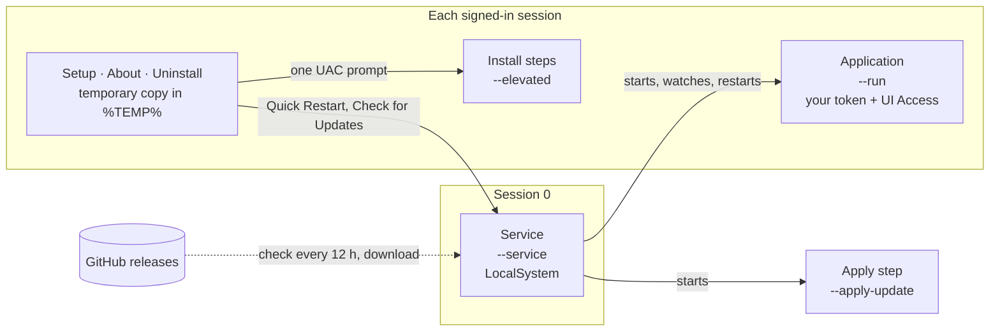
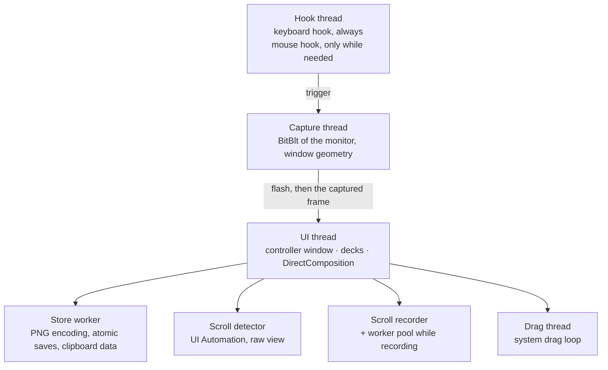
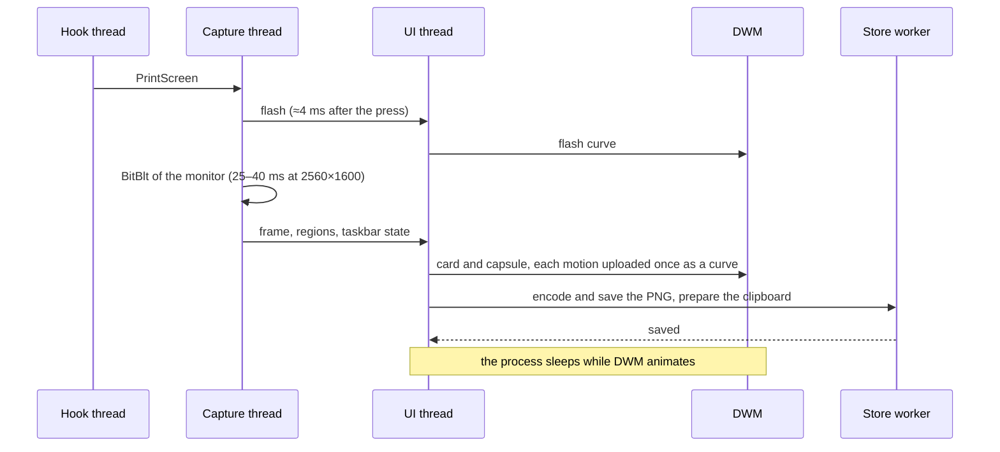

<p align="center">
  <picture>
    <source media="(prefers-color-scheme: dark)" srcset="docs/media/hero-dark.png">
    
  </picture>
</p>

<p align="center">
  <a href="https://github.com/Jason-JP-Yang/Screenshot-Toolkit/releases"></a>
  <a href="https://github.com/Jason-JP-Yang/Screenshot-Toolkit/actions/workflows/release.yml"></a>
  
  
  <a href="LICENSE"></a>
</p>

<p align="center">
  <a href="#install"><b>Install</b></a> &nbsp;·&nbsp;
  <a href="#using-it"><b>Using it</b></a> &nbsp;·&nbsp;
  <a href="#scrolling-screenshots"><b>Scrolling screenshots</b></a> &nbsp;·&nbsp;
  <a href="#settings"><b>Settings</b></a> &nbsp;·&nbsp;
  <a href="#developer-guide"><b>Developer guide</b></a>
</p>

<br>

Screenshot Toolkit replaces the Windows Snipping Tool with something you barely notice. Press <kbd>PrtSc</kbd> and the whole screen is captured on the spot, without freezing it. A thumbnail lands in the bottom-left corner on a spring, the PNG is already in your Gallery, and the image is already on your clipboard. Pick a different region, drag it into a conversation, or just keep working: in three seconds it slides away on its own.

There is no tray icon, no editor, and no settings window. The program runs quietly in the background, and the only window it has is for installing, updating, and restarting it.

<p align="center">
  
</p>
<p align="center"><sub><kbd>PrtSc</kbd>, then <kbd>Win</kbd> <kbd>Shift</kbd> <kbd>→</kbd> twice to keep only the browser window, then a drag into the conversation.</sub></p>

<br>

<table>
  <tr>
    <td width="33%" valign="top"><b>Instant</b><br><sub>The capture happens on the key press. The thumbnail is on screen about 50 ms later, and saving and copying never hold it up.</sub></td>
    <td width="33%" valign="top"><b>The right region, after the fact</b><br><sub>Whole screen, screen without taskbar, the top app, or any window of a Snap layout. Each choice is drawn from the shot's real geometry.</sub></td>
    <td width="33%" valign="top"><b>Scrolling screenshots</b><br><sub>Scroll the way you normally would. The long image is built pixel by pixel, with fixed headers shown once and nothing ghosted.</sub></td>
  </tr>
  <tr>
    <td valign="top"><b>Gestures, not dialogs</b><br><sub>Drag the thumbnail into any app, swipe it away, click to open it, or drop it on the rubbish bin to delete it.</sub></td>
    <td valign="top"><b>Above everything</b><br><sub>Thumbnails stay above Start and Task View, and the hotkeys work over administrator windows.</sub></td>
    <td valign="top"><b>Light when idle</b><br><sub>About 0.2 MB of working set between screenshots, no timers on the UI thread, and silent updates from this repository.</sub></td>
  </tr>
</table>

## Install

1. Download `ScreenshotToolkit-<version>.exe` from the [releases page](https://github.com/Jason-JP-Yang/Screenshot-Toolkit/releases). The newest build is at the top. Every build is a pre-release while the project is in beta.
2. Open it and choose **Quick Install**. Windows asks for administrator approval once.
3. Press <kbd>PrtSc</kbd>.

<p align="center">
  <picture>
    <source media="(prefers-color-scheme: dark)" srcset="docs/media/setup-dark.png">
    
  </picture>
</p>

> [!NOTE]
> Releases are signed with a self-signed certificate, so SmartScreen may say the publisher is unknown when the file is freshly downloaded. Choose **More info**, then **Run anyway**. Each release also lists its SHA-256 if you want to check the file first.

The setup window follows the Windows light or dark app theme, and its button folds into a progress bar while it works. Opening a newer copy the same way updates the installed one. Built for 64-bit Windows 11, and Windows 10 version 2004 or later.

<details>
<summary><b>What Quick Install does</b></summary>
<br>

1. Stops any running copy, including one from an earlier version.
2. Copies the program to `Program Files\Screenshot Toolkit`.
3. Writes `%ProgramData%\Screenshot Toolkit\settings.ini`, unless one is already there.
4. Adds Screenshot Toolkit to **Settings › Apps** and to the Start menu for everyone on the PC. No desktop icon.
5. Registers and starts the **Screenshot Toolkit** service, which starts the program in every signed-in session from then on, and again within a second if it is ended or crashes.

There is no custom install. Screenshots are never touched by installing, updating, or uninstalling.
</details>

<details>
<summary><b>The About window, quitting, and uninstalling</b></summary>
<br>

Opened from Start, the installed program shows its **About** window: the version, whether it is running, **Check for Updates**, and **Quit**. While the program is not running, Quit reads **Quick Restart**. A quit lasts until Quick Restart or the next sign-in.

To remove it, open **Settings › Apps** and choose **Uninstall**. The same window opens with a deep red **Uninstall** button, which removes the service, the program, its settings, its Start menu and Settings entries, any update waiting to be installed, and whatever earlier versions left behind. Screenshots stay where they were saved.

The About and uninstall windows run from a copy in `%TEMP%` that deletes itself when they close, so they never hold the installed file open.
</details>

<details>
<summary><b>Command line</b></summary>
<br>

| Command | What it does |
|---|---|
| *(none)* | The setup window, or the About window when this is the installed copy |
| `--install` | The setup window. Add `--quiet` to install without it |
| `--uninstall` | The uninstall window. Add `--quiet` to remove without it |
| `--about` | The About window |
| `--quit` | Stops the running program until Quick Restart or the next sign-in |
| `--run` | Runs the program directly, without UI Access. The service starts it this way, with `--takeover` to replace a running copy |
| `--apply-update` | Puts a downloaded update in place. Only the service starts it |
</details>

## Using it

### Take a screenshot

| Keys | Result |
|---|---|
| <kbd>PrtSc</kbd> or <kbd>Win</kbd> <kbd>Shift</kbd> <kbd>S</kbd> | Captures the monitor under the pointer, saves it, and copies it |
| <kbd>Alt</kbd> <kbd>PrtSc</kbd>, <kbd>Win</kbd> <kbd>PrtSc</kbd> | Left to Windows, as before |

Screenshots are lossless PNGs in `Pictures\Screenshots`, named like `Screenshot 2026-11-22 102412.png`. Press as often as you like: each shot stacks into a small deck in the corner and leaves on its own timer. The thumbnails never show up in the next screenshot.

### Choose the region

A capsule above the thumbnail offers every sensible region of the shot, from largest to smallest: the **whole screen**, the screen **without the taskbar**, the **top app**, each **window of a Snap layout**, and, when there is content out of view, a **scrolling screenshot**. Each icon is a tiny screen with the region filled in, drawn from where things really were, so two windows side by side are told apart at a glance. The selected one shows its name, and the capsule springs to its new width as the selection moves.

Choosing a region updates the thumbnail, the saved file, and the clipboard at once, and gives the thumbnail its full time again. Regions covering the same area are merged, and the capsule hides itself when only one is left, as for a true fullscreen app.

| Keys | Result |
|---|---|
| <kbd>Win</kbd> <kbd>Shift</kbd> <kbd>←</kbd> / <kbd>→</kbd> | Step through the regions, wrapping around at either end |
| <kbd>Win</kbd> <kbd>Shift</kbd> + side mouse buttons | The same, with the back and forward buttons |

These keys only act while a thumbnail with choices is on screen. The rest of the time they keep their Windows meaning.

### Do something with it

| Gesture | Result |
|---|---|
| **Hover** | The thumbnail stays as long as the pointer is on it |
| **Click** | Opens the image in your viewer |
| **Drag** into an app | Drops the PNG file there. A blue **+** appears when the window under the pointer will accept it; anywhere else it flies back. Timers stand still while you drag |
| **Right-click** or <kbd>Esc</kbd> during a drag | Calls the drag off. Neither press reaches the app underneath |
| **Drop on the rubbish bin** | A deep red bin rises at the bottom of the screen during every drag. Releasing over it removes the image from the clipboard and sends the file to the Recycle Bin. Drag back out to change your mind |
| **Swipe left** | Dismisses the thumbnail early. The file stays in the Gallery |

<p align="center">
  
</p>
<p align="center"><sub>A burst of three. One goes in the bin, one is swiped away, and the last leaves on its own.</sub></p>

## Scrolling screenshots

When the top app has content out of view, the capsule offers one more choice at the end: the area that scrolls, with a downward chevron cut out of it.

<table>
  <tr>
    <td width="50%" valign="top">
      
    </td>
    <td width="50%" valign="top">
      <b>1 · Choose it.</b> Select the option, then press it again or press <kbd>Win</kbd> <kbd>Enter</kbd>. <kbd>Win</kbd> <kbd>Shift</kbd> <kbd>Enter</kbd> works too, so you can keep holding Shift after stepping the selector.
      <br><br>
      <b>2 · Scroll.</b> The capsule turns into a breathing dot. Scroll the way you normally would: wheel, touchpad, scroll bar, or keyboard. The first scroll decides which area is captured, and the thumbnail grows as new content is stitched on, up to about half the screen, then follows along.
      <br><br>
      <b>3 · Finish.</b> Press <kbd>Win</kbd> <kbd>Enter</kbd>, <kbd>PrtSc</kbd>, or <kbd>Win</kbd> <kbd>Shift</kbd> <kbd>S</kbd>, click the capsule, or simply stop scrolling for five seconds.
      <br><br>
      You do not have to wait for it to finish. Pressing the thumbnail finishes the capture too, and it answers immediately: drag it, swipe it, or click it while the image is completed and saved in the background.
    </td>
  </tr>
</table>

For a moment the capsule shows how it went, then turns back into the selector with the scrolling screenshot kept as a region of its own.

<p align="center"></p>

| Outcome | Meaning |
|---|---|
| **Saved** | Finished normally. The long image is saved and on the clipboard |
| **Stopped Early, Saved** | It ended early, but had already grown by at least 10%, so that part is kept |
| **Failed** | Nothing worth keeping. The thumbnail goes back to the region chosen before |

<details>
<summary><b>What gets offered, and what ends a recording early</b></summary>
<br>

The program looks for content out of view in the background, right after the shot is on screen. It never scrolls or clicks anything to find out, so no window reacts. Only what the app itself reports through UI Automation counts:

- Something says it shows only part of its content. That covers native lists and documents, and in browsers and the apps built on them, every plain box that scrolls.
- Items stacked in a container run past the edge that clips them, or a list reports more items than it has drawn.
- A text document, such as a terminal or an editor, reports text out of view.

Each candidate must also be what the screen really shows at that place, so a page under a dialog, behind a fullscreen video, or covered by another window does not count. Games, videos, short pages, and dialogs that fit get no scrolling option. Scroll bars play no part in the decision.

A recording ends early when the window moves or closes, when a wheel turns outside the window, or when the content stops matching for a moment, for example after a click opens another page. Something merely playing in the page, such as a video, does not end it. Each screenshot holds at most one scrolling screenshot.
</details>

<details>
<summary><b>How the long image is put together</b></summary>
<br>

- The area that scrolls is decided by what actually moves, with the pointer settling it when several things could be. An area the app reports is kept whole, as wide as the app lays it out, minus a scroll bar at its edge.
- Content enters the image where successive readings agree that it followed the scroll. Anything first seen under something else, such as a see-through bar, is taken from wherever it was later seen clearly.
- Fixed headers, floating buttons, composers, and bars that only stick partway appear once, at the end of the image nearer to where they sit, just as the screen showed them.
- A background that scrolls with the content is part of it, and a plain one keeps its color. A fixed background is rebuilt from wherever it showed and repeats down the image one view at a time, without seams where it is a pattern.
- Hover effects stay out: content near the pointer is taken from where it was seen without it.
- Fast scrolling, frames blurred in motion, and see-through windows are all followed. What was first seen blurred is retaken once the content rests. Scrolling up past the start adds content above it as well.
</details>

## Updates

The service keeps the program current from this repository's releases, dev builds included, with no administrator prompt and nothing to click.

- It looks for a newer build each time the program starts and every 12 hours, and tries again an hour after a failed check. **Check for Updates** in the About window looks right away and installs what it finds.
- A build is newer only when its build number, the count of commits on `main` that lead to it, is higher. A copy built from a commit GitHub has never seen is never replaced.
- Downloads run in the background at low priority, through the proxy your Windows settings name. A file is used only once its size and SHA-256 match the release.
- An update goes in when no thumbnail, drag, or recording is on screen and the keyboard and mouse have been still for a minute. The new copy starts before the old one lets go, so screenshots pause for a few tens of milliseconds at most, while nobody is using them.

Set `AutoUpdate=0` in [settings.ini](#settings) to stop the automatic checks. Check for Updates still works.

## Settings

Everything has a sensible default, and most people never change anything. For those who do, `%ProgramData%\Screenshot Toolkit\settings.ini` holds the settings for everyone on the PC. Editing it needs administrator rights, and a change applies after **Quit** and **Quick Restart** in the About window.

| Key | Default | Meaning |
|---|---|---|
| `GalleryFolder` | *(empty)* | Where screenshots are saved. Empty means `Pictures\Screenshots`. Variables such as `%USERPROFILE%` work |
| `DwellSeconds` | `3` | Seconds a thumbnail stays on screen |
| `CaptureIncludesThumbnails` | `0` | `1` lets screenshots show the program's own thumbnails |
| `DeleteToRecycleBin` | `1` | `0` deletes screenshots dropped on the rubbish bin for good |
| `AutoUpdate` | `1` | `0` stops the automatic update checks |

<details>
<summary><b>Privacy and permissions</b></summary>
<br>

Screenshots never leave your PC. The only network traffic is checking this repository's GitHub releases for updates and downloading them, and `AutoUpdate=0` turns the automatic part off.

The program itself runs as you, without administrator rights, so drag and drop, the clipboard, and opening files behave like any other app. It carries the **UI Access** right, as Magnifier and the on-screen keyboard do. That is what lets thumbnails sit above Start and Task View and lets the hotkeys work while an administrator window has focus. Granting that right takes SYSTEM, which is why a small service starts the program. It is also why the program lives in Program Files: a file the service starts without asking must be one that only administrators can replace. Keys are only intercepted while the program is running; if it is not, Windows behaves as usual.
</details>

<br>

---

<br>

# Developer guide

Screenshot Toolkit is a single native Win32 program written in C++20. It has no third-party dependencies: rendering goes through DirectComposition and Direct3D 11, images through WIC, downloads through WinHTTP, and the long-image work is plain C++ with SSE2. This guide covers how the repository is organized, how to build and run it, how the pieces fit together, and how changes are verified and released.

## Repository layout

```text
.
├── CMakeLists.txt            Build definition; the version number lives here
├── CHANGELOG.md              User-facing changes, with an "Unreleased" section on top
├── include/sstk/<module>/    Headers, one folder per module
│   └── config/               The default build's tunables (headers only)
├── src/<module>/             Sources, mirroring include/
├── res/                      Application manifest (UI Access) and version resource
├── scripts/                  Build, local release, version stamping, signing, release notes
├── docs/media/               Images used by this README
└── .github/workflows/        The release pipeline
```

Code includes headers by module, for example `#include "sstk/overlay/capsule.h"`. New files go into the module they belong to, never directly under `src/`.

| Module | What lives there |
|---|---|
| `app` | `main.cpp`: mode dispatch, the message loop, clipboard installation, memory trimming |
| `base` | Win32 includes and tracing (`platform`), product names and install paths (`product`), `settings.ini` (`settings`), the worker pool used by scrolling screenshots (`workers`) |
| `brand` | `iconbake.cpp`, a build-time tool that draws the icon in code and bakes it into an `.ico` |
| `capture` | Low-level keyboard and mouse hooks (`hook`), the capture thread (`capture`), window geometry, taskbar state, Snap layouts, and the region list (`screen`) |
| `config` | Animation, colors, core behavior, hotkeys, and layout defaults |
| `graphics` | Resampling, frosted glass, shadows, glyphs, and text (`image`), pixel helpers (`pixels.h`), springs as DirectComposition curves (`motion`), the WARP device (`compositor`) |
| `overlay` | The per-monitor deck (`overlay`), one screenshot (`card`), the region selector (`capsule`), the thumbnail in the air (`sprite`), the rubbish bin (`bin`), and the drag loop thread (`dragdrop`) |
| `scroll` | Finding content out of view (`scrollable`), recording (`recorder`), motion between readings (`tracker`), building the long image (`stitcher`), and packed storage for it (`longimage`) |
| `service` | The LocalSystem service that starts the program in each session, restarts it, and drives updates |
| `setup` | The elevated install and uninstall steps (`installer`), and the setup, uninstall, and About window (`window`) |
| `storage` | PNG encoding, atomic saves, clipboard data, and the in-memory archive of each frame (`store`) |
| `update` | When to check and what to download (`updater`), the apply step (`apply.cpp`), shared state in the registry (`state`), HTTPS with the user's proxy and SHA-256 (`http`), and a small JSON reader (`json`) |

## Building

**You need** Windows 10 or 11 x64 with:

- Visual Studio 2022 or newer, or its Build Tools, with the **Desktop development with C++** workload (MSVC and a current Windows SDK)
- CMake 3.21 or newer and Ninja (the copies that come with Visual Studio work)
- Git, which stamps each build with its commit

From the repository root:

```powershell
scripts\build.cmd Release
```

The script finds the newest Visual Studio installation with `vswhere`, loads its x64 environment, configures `build\Release` with Ninja, and builds. The result is `build\Release\ScreenshotToolkit.exe`. Use `Debug` instead of `Release` for an unoptimized build in `build\Debug`.

The configure step also writes `compile_commands.json`, so clangd, VS Code, and CLion understand the project without extra setup. Visual Studio can open the folder directly as a CMake project.

<details>
<summary><b>What happens during a build</b></summary>
<br>

1. `scripts/version.cmake` runs on every build and writes two files under `build/<config>/generated/`: a header with the version name and build number, and a source file with the build's UTC time. Each is rewritten only when its content changes, so a new commit is the only thing that forces a recompile.
2. `sstk_iconbake` is built and run. It draws the icon with the same code the program uses for its other graphics and writes `app.ico`, which `res/app.rc` embeds. There is no image file to keep in step.
3. The program is linked with link-time code generation in Release. The rendering, codec, shell, and networking DLLs are delay-loaded, so the SYSTEM service, which shares the executable, never maps them.

Builds are named `vX.Y.Z[-dev]-<commit>-beta`, for example `v0.2.0-dev-1a2b3c4d-beta`. `dev` is dropped only when `HEAD` is exactly the commit tagged `vX.Y.Z`.
</details>

## Running a development build

Only one copy runs per session, so stop the installed one first. A deliberate quit stays down, and the service will not bring it back until you ask.

```powershell
& "$env:ProgramFiles\Screenshot Toolkit\ScreenshotToolkit.exe" --quit
```

```powershell
.\build\Release\ScreenshotToolkit.exe --run
```

A development build started with `--run` works like the installed program, with two differences that come from not having UI Access: its thumbnails stay below Start and Task View, and its hooks do not see keys pressed while an administrator window has focus. To test those two behaviors, install the build with `--install` instead, and set `AutoUpdate=0` in settings.ini meanwhile so a newer release does not replace it.

When you are done, stop the development build with `--quit`, then bring the installed one back with **Quick Restart** in its About window, or by signing out and in.

Three environment variables help during development:

| Variable | Effect |
|---|---|
| `SSTK_TRACE` | Appends timings and lifecycle events to `%TEMP%\ScreenshotToolkit.log` |
| `SSTK_GALLERY_DIR` | Saves screenshots to another folder, overriding `settings.ini`, so test shots stay out of your Gallery |
| `SSTK_DEBUG_VISIBLE` | Makes the overlay capturable, so screen recorders and frame-sampling tools can see the animation. Screenshots then contain the thumbnails too, so never ship or hand out a build run this way |

```powershell
$env:SSTK_TRACE = '1'; $env:SSTK_GALLERY_DIR = "$env:TEMP\sstk-shots"; .\build\Release\ScreenshotToolkit.exe --run
```

## How it fits together

### One executable, many roles

Everything ships as one file, and the arguments decide what it becomes. Installing and updating therefore replace a single file, and the SYSTEM service loads no DLLs from disk beyond the system's own.



The service only starts and supervises the application. An application that is ended or crashes is back within a second, more slowly if it keeps failing straight away, while one that exits cleanly stays down until Quick Restart or the next sign-in. Should the service itself fail, Windows restarts it, and it adopts the applications already running.

### Inside the application

The application keeps each kind of work on its own thread, so nothing slow can delay the first frame of a screenshot.



A press travels like this:



### Rendering and motion

Every visible element is a DirectComposition visual. Springs have a closed-form solution, so each animated value is uploaded once as a chain of cubic segments and DWM evaluates it at the display's refresh rate. The process sleeps during animation and the motion is immune to CPU load. Values that follow the pointer, such as a thumbnail being dragged, are stepped once per composed frame instead.

Drawing goes through a WARP device that only hands pixels to DirectComposition, while DWM composes on the GPU. Measured on an RTX 4060 laptop, this makes device creation about ten times faster than the vendor driver (8–18 ms against 100–200 ms) and avoids roughly 80 MB of committed memory.

<details>
<summary><b>Where the time and memory go</b></summary>
<br>

- **Idle.** After each session the process returns its working set, leaving about 0.2 MB of private working set. Pages stay cached, so the next press only takes soft page faults. The only recurring wake-up is a keyboard hook refresh every five minutes, because Windows silently drops hooks it once found slow.
- **A screenshot on screen.** A thumbnail is prepared for every region when the shot is taken, and the raw frame is released as soon as the PNG is saved. That leaves about 15 MB per session, and a burst of five stays near 8 MB. Switching regions uploads nothing; crops come from the PNG kept in memory.
- **Dragging.** The system drag loop calls into whatever application is under the pointer and can block there, so it runs on its own thread. The UI thread wakes once per composed frame only while a thumbnail is in the air.
- **Mouse hook.** A low-level mouse hook wakes the process on every pointer move, so it exists only while a thumbnail with choices or a drag is on screen.
- **Scrolling screenshots.** Detection runs on its own thread after the shot is shown. While recording, the window is read about every 90 ms, every 25 ms while things move, and each reading is reduced to an edge map. Strips of columns propose shifts, 16×16 cells confirm them, and each reading is placed against the rows already held, so errors cannot add up. Rows are kept packed in address space reserved up front, and only changed thumbnail rows are redrawn.
- **The desktop is left alone.** The overlay stops one pixel short of covering the monitor. A window covering it would count as a fullscreen app, and Windows would drop the taskbar behind everything.
</details>

### Why one executable

Keeping everything in one file makes installing and updating a single-file operation and gives the SYSTEM service nothing extra to load. Each part lives in its own module, so splitting is mechanical when one of these arrives:

- **A larger interface**, such as a settings window. It would move into its own executable, run as the user, leaving the resident program smaller.
- **Updating while the program runs.** A small separate service executable could then replace the application's file without stopping itself.
- **Code shared with other programs**, such as plugins. That code would become a DLL with a plain C interface, loaded only from the install folder.

A split would also add a manifest of installed files for the uninstaller, in place of the single folder it removes today.

## Tuning the defaults

The default build's behavior is defined in five headers under `include/sstk/config/`. Change a value and rebuild. A handful of them can also be overridden at run time in [settings.ini](#settings).

| Header | What it sets |
|---|---|
| `animation.h` | Every spring, as `{response, damping}`, plus timings for the flash, the deck, the selector, dragging, and the rubbish bin |
| `colors.h` | The "Graphite Glass" palette, shadows, the outcome colors of a scrolling screenshot, the icon, and the setup window in both themes |
| `core.h` | Dwell time, what a shot contains, deletion, which windows become regions, and how scrolling screenshots sample, match, and end |
| `hooks.h` | The keys and mouse buttons that capture, step the selector, start and finish a scrolling screenshot, and cancel a drag |
| `layout.h` | Sizes, spacing, label text, and fonts, including the setup window's |

The visual language is deliberately monochrome: warm graphite and porcelain, so the screenshot is the only color on screen. Hue appears only where a drag asks a question (blue: this drop will land; red: this will delete). Colors are flat, with neutral shadows and no gradients or glows. Please keep new UI within that language.

## Verifying changes

There is no automated test suite yet. The program is a thin layer over input hooks, the compositor, and other applications, so changes are verified by running them. A useful pass before opening a pull request:

- **Build clean.** `scripts\build.cmd Release` with no warnings at `/W4`.
- **Capture.** PrintScreen and Win+Shift+S on each monitor, including mixed DPI, and fast bursts that stack the deck.
- **Regions.** A Snap layout, a maximized window, a true fullscreen app (the capsule should hide), and the taskbar on another edge or set to auto-hide.
- **Gestures.** Drag into Explorer, a browser, and a chat app; cancel with right-click and Esc; the rubbish bin with `DeleteToRecycleBin` on and off; swipe and click.
- **Shell surfaces.** With an installed build, thumbnails above Start, Task View, and Quick Settings, and the hotkeys over an administrator window.
- **Scrolling screenshots.** A Chromium page with plain `overflow: auto` boxes and sticky headers, a native list, the Settings app (see-through material), and a terminal. Check the negatives too: a game, a video, a short page.
- **Footprint.** With `SSTK_TRACE` set, the log reports the commit charge after each trim; it should return to its idle level once the thumbnails are gone.

## Commits, versions, and releases

- **Commits** follow [Conventional Commits](https://www.conventionalcommits.org/): `feat(scope): …`, `fix(scope): …`, `perf`, `ci`, `chore`. The scope is usually a module name.
- **Changelog.** Add user-facing changes under `## Unreleased` in `CHANGELOG.md` as you go.
- **Version.** The number lives in `project(... VERSION X.Y.Z)` in `CMakeLists.txt`. The build number is the count of commits that lead to `HEAD`, and installed copies only ever update to a higher one.

GitHub Actions publishes every release from `.github/workflows/release.yml`, all marked as pre-releases while the project is in beta:

- Each push to `main` publishes its newest commit as **the** dev build, with the changelog's Unreleased section and a comparison link, and removes the previous dev build. Pushes in quick succession publish only the newest.
- Each `vX.Y.Z` tag without a release is built from that tag and published with its changelog section. Running the workflow by hand with **rebuild** publishes every version again, for example after the signing certificate changes.

To cut a version: move the Unreleased entries under a new `## X.Y.Z` heading, set the same version in `CMakeLists.txt`, commit, tag the commit `vX.Y.Z`, and push the branch and the tag. `scripts\release.cmd` builds the same thing locally into `release\<version>\`, a folder git ignores; tag first so the build carries no `dev`.

<details>
<summary><b>Signing</b></summary>
<br>

Releases are signed with a self-signed certificate and timestamped by `scripts/sign.ps1`. The signature proves that the file is unchanged and which certificate signed it, but Windows does not trust a self-signed certificate, so SmartScreen can still call the publisher unknown.

Without further setup, each build is signed with a certificate made for it alone. To sign every release with the same certificate, run this once on your own machine:

```powershell
powershell -File scripts\new-signing-cert.ps1
```

Then add the two values it prints as repository secrets, `SIGNING_PFX` and `SIGNING_PASSWORD`, under **Settings › Secrets and variables › Actions**. Importing its `signing.cer` into a machine's Trusted Root Certification Authorities makes that machine show the signature as valid.
</details>

## Contributing

Issues and pull requests are welcome. Screenshot Toolkit is intentionally small, so for anything that adds a surface (a window, a setting, a new gesture), please open an issue first to talk about whether it fits. For pull requests:

- Keep each change focused, and describe what you verified and on which Windows version and display setup.
- Put new tunables in `include/sstk/config/` rather than in source files.
- Prefer exact refactors for performance work: the same pixels, the same decisions, and no lower sampling rates.
- Comments explain why, not what. Keep them short.

## License

Licensed under the [Apache License 2.0](LICENSE). See [NOTICE](NOTICE) for attribution.
