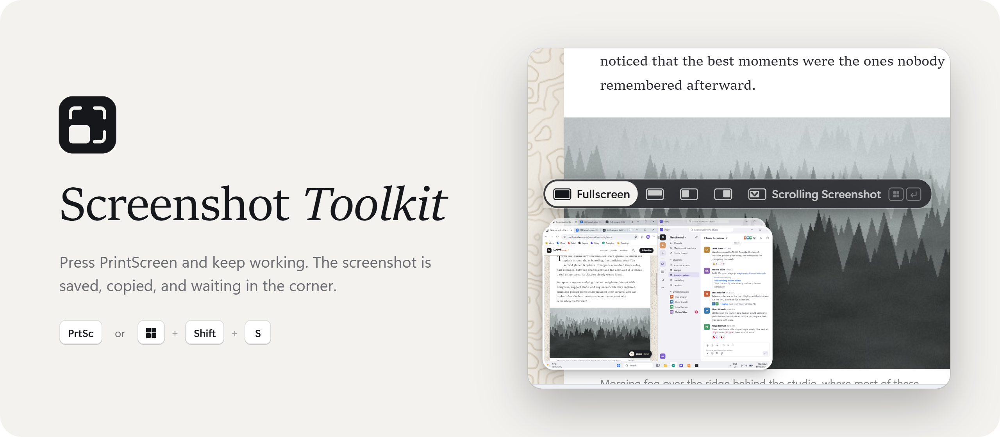
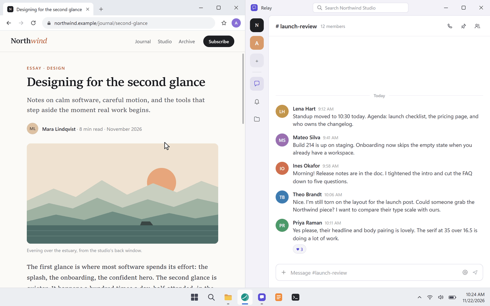
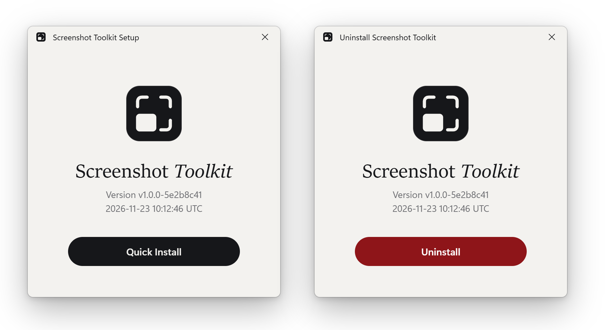
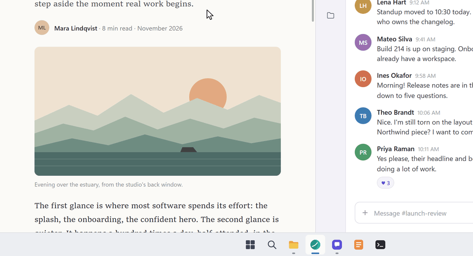
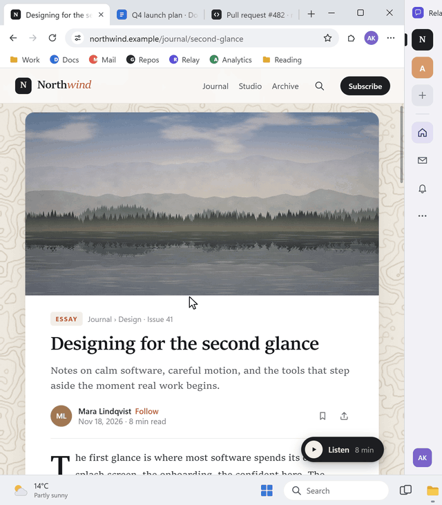
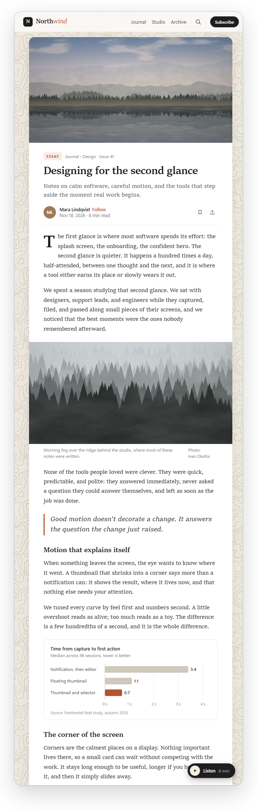
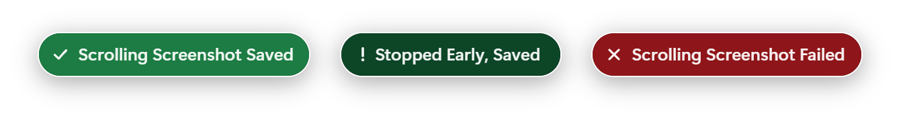
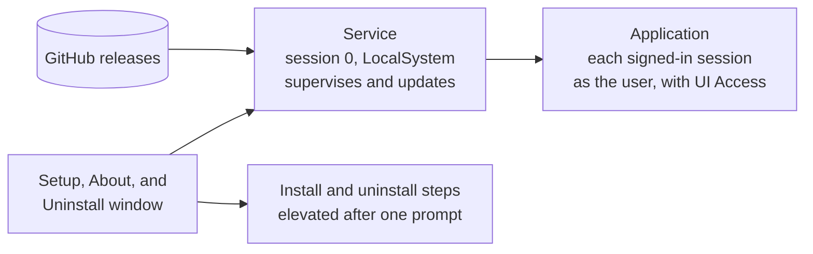
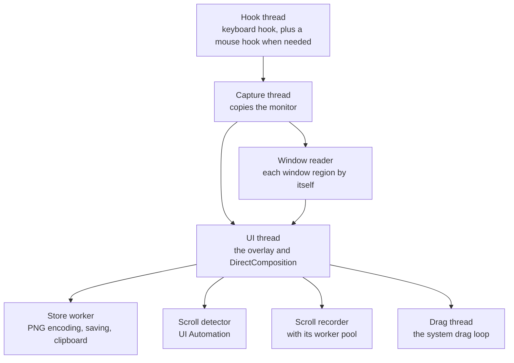
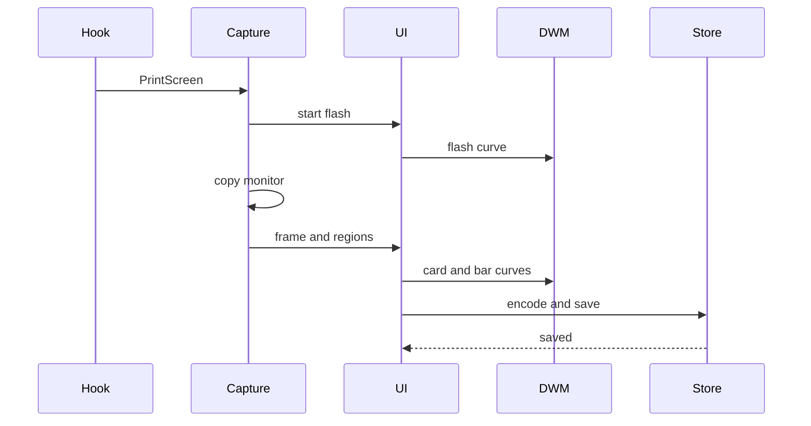

<p align="center">
  <picture>
    <source media="(prefers-color-scheme: dark)" srcset="docs/media/hero-dark.png">
    
  </picture>
</p>

<p align="center">
  <a href="https://github.com/Jason-JP-Yang/Screenshot-Toolkit/releases"></a>
  <a href="https://github.com/Jason-JP-Yang/Screenshot-Toolkit/actions/workflows/release.yml"></a>
  
  
  <a href="LICENSE"></a>
</p>

<p align="center">
  <a href="#install"><b>Install</b></a> &nbsp;·&nbsp;
  <a href="#taking-screenshots"><b>Using it</b></a> &nbsp;·&nbsp;
  <a href="#scrolling-screenshots"><b>Scrolling screenshots</b></a> &nbsp;·&nbsp;
  <a href="#settings"><b>Settings</b></a> &nbsp;·&nbsp;
  <a href="#developer-guide"><b>Developer guide</b></a>
</p>

<br>

Screenshot Toolkit is a screenshot tool for Windows that stays out of your way. Press <kbd>PrtSc</kbd> and the whole screen is captured at that instant. The screen doesn't freeze or dim, and there is no rectangle to draw. A thumbnail of the shot settles into the bottom-left corner, and by the time it lands, the PNG is saved and the image is on your clipboard.

You can leave it there and carry on. If you want only one window, change the region from the thumbnail. If the shot is meant for someone, drag the thumbnail into the conversation. After three seconds it slides away by itself.

<p align="center">
  
</p>
<p align="center"><sub>A teammate asks for the article. <kbd>PrtSc</kbd>, then <kbd>Win</kbd> <kbd>Shift</kbd> <kbd>→</kbd> twice to keep only the browser window, then a drag into the chat.</sub></p>

<br>

<table>
  <tr>
    <td width="33%" valign="top"><b>Your work keeps going</b><br><sub>The capture is taken the moment the key goes down, and nothing on screen stops or waits for you. Scroll, type, or switch windows straight away.</sub></td>
    <td width="33%" valign="top"><b>As many as you like</b><br><sub>Every press is its own screenshot. They stack up in the corner, each saved separately and each leaving on its own timer.</sub></td>
    <td width="33%" valign="top"><b>Choose the region afterwards</b><br><sub>Whole screen, screen without the taskbar, the active window, or either side of a Snap layout. One key press moves between them.</sub></td>
  </tr>
  <tr>
    <td valign="top"><b>Scrolling screenshots that hold up</b><br><sub>Sticky headers and floating buttons appear once. Fixed backgrounds are rebuilt behind the page instead of being smeared down it.</sub></td>
    <td valign="top"><b>Drag it where it's needed</b><br><sub>Drop the thumbnail into a chat, an email, or a folder. Swipe it away, or drop it on the rubbish bin to delete it.</sub></td>
    <td valign="top"><b>Light on the system</b><br><sub>No tray icon and no settings window. Between screenshots it holds about 0.2 MB of memory, and it keeps itself up to date.</sub></td>
  </tr>
</table>

## Install

1. Download `ScreenshotToolkit-<version>.exe` from the [releases page](https://github.com/Jason-JP-Yang/Screenshot-Toolkit/releases). The newest build is at the top. All builds are marked as pre-releases while the project is in beta.
2. Run it and choose **Quick Install**. Windows asks for administrator approval once.
3. Press <kbd>PrtSc</kbd>.

<p align="center">
  <picture>
    <source media="(prefers-color-scheme: dark)" srcset="docs/media/setup-dark.png">
    
  </picture>
</p>
<p align="center"><sub>Setup, and the window that <b>Settings › Apps › Uninstall</b> opens. Both follow the Windows light or dark theme.</sub></p>

> [!NOTE]
> Releases are signed with a self-signed certificate, so SmartScreen may describe the publisher as unknown the first time you run a download. Choose **More info**, then **Run anyway**. Each release also lists the file's SHA-256 if you would like to check it first.

To update by hand, run a newer copy the same way; it replaces the installed one. Screenshot Toolkit needs 64-bit Windows 11, or Windows 10 version 2004 or later.

<details>
<summary><b>What Quick Install does</b></summary>
<br>

1. Stops any running copy, including one from an earlier version.
2. Copies the program to `Program Files\Screenshot Toolkit`.
3. Writes `%ProgramData%\Screenshot Toolkit\settings.ini`, unless one is already there.
4. Adds Screenshot Toolkit to **Settings › Apps** and to the Start menu for everyone on the PC. It doesn't add a desktop icon.
5. Allows the program through Microsoft Defender's **Controlled folder access**, so it can still save to Pictures when that protection is on. Updates renew this, and uninstalling removes it.
6. Registers and starts the **Screenshot Toolkit** service. From then on the service starts the program whenever someone signs in, and starts it again within a second if it is ended or crashes.

There are no options to choose. Installing, updating, and uninstalling never touch your screenshots.
</details>

<details>
<summary><b>Quitting, restarting, and uninstalling</b></summary>
<br>

Opening Screenshot Toolkit from the Start menu shows its **About** window: the version, whether it is running, and two buttons, **Check for Updates** and **Quit**. While the program isn't running, the second button reads **Quick Restart** instead. A quit lasts until you choose Quick Restart or sign in again.

To uninstall, open **Settings › Apps** and choose **Uninstall** next to Screenshot Toolkit. The window shown above opens with a deep red **Uninstall** button. It removes the service, the program, its settings, its Start menu and Settings entries, any update waiting to be installed, and anything earlier versions left behind. Your screenshots stay where they are.

The About and uninstall windows run from a temporary copy in `%TEMP%` that deletes itself when the window closes, so they never keep the installed file open.
</details>

<details>
<summary><b>Command line</b></summary>
<br>

| Command | What it does |
|---|---|
| *(none)* | Opens the setup window, or the About window when run from the installed copy |
| `--install` | Opens the setup window. Add `--quiet` to install without it |
| `--uninstall` | Opens the uninstall window. Add `--quiet` to remove the program without it |
| `--about` | Opens the About window |
| `--quit` | Stops the running program until Quick Restart or the next sign-in |
| `--run` | Runs the program directly, without UI Access. The service starts it this way, adding `--takeover` to replace a running copy |
| `--apply-update` | Puts a downloaded update in place. Only the service uses it |
</details>

## Taking screenshots

| Keys | What happens |
|---|---|
| <kbd>PrtSc</kbd> or <kbd>Win</kbd> <kbd>Shift</kbd> <kbd>S</kbd> | Captures the monitor the pointer is on, saves it, and copies it |
| <kbd>Alt</kbd> <kbd>PrtSc</kbd> and <kbd>Win</kbd> <kbd>PrtSc</kbd> | Left to Windows, as before |

Screenshots are saved as lossless PNGs in `Pictures\Screenshots`, with names like `Screenshot 2026-11-22 102412.png`. Each press makes a new screenshot, so you can press again as soon as something changes. New thumbnails go on top of the ones still in the corner, and the thumbnails themselves never appear in the next shot.

## Choosing the region

The bar above the thumbnail lists the regions the shot can be cropped to, from largest to smallest: the **whole screen**, the screen **without the taskbar**, the **active window**, and each **window of a Snap layout**. When the active window has more to scroll through, a **scrolling screenshot** comes last. Each icon is a small picture of the screen with that region filled in, drawn from where the windows really were, so two windows side by side are easy to tell apart.

A window region holds that window alone, read by itself a moment after the shot. A notification or the taskbar lying over it stays out, and any part reaching past the edge of the screen is included.

Choosing a region updates the thumbnail, the saved file, and the clipboard together, and gives the thumbnail its full three seconds again. Regions that cover the same area are listed once. When only one is left, as with a fullscreen game, the bar doesn't appear at all.

| Keys | What happens |
|---|---|
| <kbd>Win</kbd> <kbd>Shift</kbd> <kbd>←</kbd> / <kbd>→</kbd> | Moves to the previous or next region, wrapping around at the ends |
| <kbd>Win</kbd> <kbd>Shift</kbd> with the mouse's side buttons | The same, with the back and forward buttons |

These keys only do this while a thumbnail with more than one region is on screen. The rest of the time Windows handles them as usual.

## After the shot

| Gesture | What happens |
|---|---|
| **Hover** | The thumbnail stays for as long as the pointer is on it |
| **Click** | Opens the image in your default viewer |
| **Drag** into an app | Drops the PNG file there. A blue **+** appears when the window under the pointer will accept it. Let go anywhere else and the thumbnail flies back. Thumbnails don't time out while you drag |
| **Right-click** or <kbd>Esc</kbd> while dragging or swiping | Cancels it, and the thumbnail goes back. The app underneath never sees the click or the key |
| **Drop on the rubbish bin** | A red bin rises at the bottom of the screen during every drag. Releasing over it removes the image from the clipboard and moves the file to the Recycle Bin. Drag back out before releasing to keep it |
| **Swipe left** | Dismisses the thumbnail early. The file stays in your screenshots folder |

<p align="center">
  
</p>
<p align="center"><sub>Three screenshots while reading. One goes in the bin, one is swiped away, and the last leaves on its own.</sub></p>

## Scrolling screenshots

When the active window has more content than fits on screen, the region bar offers one more option at the end, **Scrolling Screenshot**. Choose it, scroll the way you normally would, and the thumbnail grows as the page is stitched together.

<table>
  <tr>
    <td width="52%" valign="top">
      
    </td>
    <td width="48%" valign="top">
      <b>1. Start.</b> Select the option, then click it again or press <kbd>Win</kbd> <kbd>Enter</kbd>. <kbd>Win</kbd> <kbd>Shift</kbd> <kbd>Enter</kbd> also works, so Shift can stay down after choosing the region.
      <br><br>
      <b>2. Scroll.</b> The bar shows a softly pulsing dot. Use the mouse wheel, the touchpad, the scroll bar, or the keyboard. Whatever you scroll first is what gets captured. The thumbnail grows to about half the height of the screen and then follows along.
      <br><br>
      <b>3. Finish.</b> Press <kbd>Win</kbd> <kbd>Enter</kbd>, <kbd>PrtSc</kbd>, or <kbd>Win</kbd> <kbd>Shift</kbd> <kbd>S</kbd>, click the bar, or stop scrolling for five seconds.
      <br><br>
      You can also end the capture by pressing the thumbnail. It responds at once, so you can drag, swipe, or open it while the long image is still being finished in the background.
    </td>
  </tr>
</table>

### What it gets right

Long pages are where scrolling captures usually go wrong: headers repeat every screen, backgrounds smear, and whatever sat under the pointer ends up in the picture. This is the long image from the demo above, shown at half size.

<table>
  <tr>
    <td width="40%" valign="top"></td>
    <td width="60%" valign="top">
      <b>Sticky and floating elements appear once.</b> The site header sits at the top of the image, and the floating <i>Listen</i> button sits at the bottom, where it was when scrolling stopped. Neither is repeated down the page.
      <br><br>
      <b>Fixed backgrounds are rebuilt, not smeared.</b> The topographic pattern behind the article never moved while the page scrolled. It is reconstructed from everywhere it showed between and beside the content, and continues behind the whole image without seams.
      <br><br>
      <b>See-through bars don't tint the content.</b> Text and photos that passed under the translucent header are taken from where they were seen clearly.
      <br><br>
      <b>Hover effects stay out.</b> The pointer rested over the article the whole time. Anything near it is taken from frames where it wasn't affected.
      <br><br>
      <b>Fast or uneven scrolling is fine.</b> Each frame is matched against everything captured so far, so errors don't add up. Frames blurred by motion are replaced once the page settles.
    </td>
  </tr>
</table>

When it ends, the bar shows the result for a moment, then turns back into the region bar with the long image kept as a region of its own.

<p align="center"></p>

| Result | Meaning |
|---|---|
| **Saved** | It finished normally. The long image is saved and on the clipboard |
| **Stopped Early, Saved** | It ended before you finished, but had already grown by at least 10%, so what it had is kept |
| **Failed** | There was nothing worth keeping. The thumbnail returns to the region chosen before |

<details>
<summary><b>When the option is offered, and what ends a capture early</b></summary>
<br>

Right after a shot, the program checks in the background whether the active window has content out of view. It never scrolls or clicks anything to find out, so nothing on screen reacts. It relies only on what the app reports through UI Automation:

- A control reports that it shows only part of its content. This covers native lists and documents, and in browsers and apps built on them, any element that scrolls.
- Items in a container run past the edge that clips them, or a list reports more items than it has drawn.
- A text document, such as a terminal or a code editor, reports text out of view.

The candidate also has to be what is actually visible at that spot. A page behind a dialog, behind a fullscreen video, or under another window doesn't count. Games, videos, short pages, and dialogs that already fit get no scrolling option. Scroll bars play no part in the decision.

The option stays while the window still shows what the shot did. After a click, a scroll, or a key press anywhere but on the thumbnail or its region bar, the window is compared with the shot a few times a second. Scrolling within reach of it, typing, or a part changing by itself, such as a playing video, keeps the option. Content replaced across nearly all of what scrolls, as when a link opens another page, takes it away, and so does the window moving or changing size.

The window is read by itself while it is captured, so a notification passing over it stays out of the image, and an area reaching past the edge of the screen is captured whole.

A capture ends early if the window moves or closes, if you turn the wheel outside the window, or if the content stops matching for a moment, for example after a click opens a different page. A video playing inside the page doesn't end it. Each screenshot can hold one scrolling screenshot.
</details>

## Updates

The installed service keeps Screenshot Toolkit up to date from this repository's releases, including dev builds. There is nothing to click and no administrator prompt.

- It checks each time the program starts and every 12 hours after that, and retries an hour after a failed check. **Check for Updates** in the About window checks immediately and installs whatever it finds.
- A build counts as newer only if its build number, the number of commits on `main` behind it, is higher. A build made from a commit that isn't on GitHub is never replaced.
- Downloads run in the background at low priority, through the proxy set in your Windows settings. A file is only used once its size and SHA-256 match the release.
- The update is installed when no thumbnail, drag, or scrolling capture is on screen and the keyboard and mouse have been idle for a minute. The new version starts before the old one exits, so screenshots are unavailable for at most a few tens of milliseconds.

Set `AutoUpdate=0` in [settings.ini](#settings) to turn off the automatic checks. **Check for Updates** still works.

## Settings

Most people never need to change anything. If you do, the settings for everyone on the PC are in `%ProgramData%\Screenshot Toolkit\settings.ini`. Editing the file requires administrator rights, and changes take effect after **Quit** and **Quick Restart** in the About window.

| Key | Default | Meaning |
|---|---|---|
| `GalleryFolder` | *(empty)* | Where screenshots are saved. Empty means `Pictures\Screenshots`. Variables such as `%USERPROFILE%` work |
| `DwellSeconds` | `3` | How many seconds a thumbnail stays on screen |
| `CaptureIncludesThumbnails` | `0` | Set to `1` to let screenshots include the program's own thumbnails |
| `DeleteToRecycleBin` | `1` | Set to `0` to delete screenshots dropped on the rubbish bin permanently |
| `AutoUpdate` | `1` | Set to `0` to turn off the automatic update checks |

<details>
<summary><b>Privacy and permissions</b></summary>
<br>

Screenshots never leave your PC. The only network traffic is checking this repository's releases for updates and downloading them, and `AutoUpdate=0` turns off the automatic part.

The program runs under your own account without administrator rights, so drag and drop, the clipboard, and opening files work just as they do for any other app. To be useful everywhere, a screenshot tool has to see its keys even while an administrator window has focus, and its thumbnails have to stay visible over Start and Task View. Windows allows that only for programs with the **UI Access** right, such as Magnifier and the on-screen keyboard. That right can only be granted by SYSTEM, which is why a small service starts the program. It is also why the program is installed in Program Files: the service starts it without asking, so it must be a file only administrators can replace.

The keys are only intercepted while the program is running. When it isn't, Windows behaves as usual.
</details>

<br>

---

<br>

# Developer guide

Screenshot Toolkit is a single native Win32 program written in C++20, with no third-party dependencies. Rendering uses DirectComposition and Direct3D 11, images go through WIC, downloads through WinHTTP, and the long-image work is plain C++ with SSE2. This guide explains how the repository is organized, how to build and run it, how the parts fit together, and how changes are checked and released.

## Repository layout

```text
.
├── CMakeLists.txt            Build definition; the version number is set here
├── CHANGELOG.md              User-facing changes, newest first, starting with "Unreleased"
├── include/sstk/<module>/    Headers, one folder per module
│   └── config/               Default values for the whole program (headers only)
├── src/<module>/             Sources, in the same folders as their headers
├── res/                      Application manifest (UI Access) and version resource
├── scripts/                  Build, local release, version stamping, signing, release notes
├── docs/media/               Images used in this README, and source/ that renders them
└── .github/workflows/        The release pipeline
```

Headers are included by module, as in `#include "sstk/overlay/capsule.h"`. A new file goes into the module it belongs to, never directly under `src/`, and has to be added to the source list in `CMakeLists.txt`.

| Module | Contents |
|---|---|
| `app` | `main.cpp`: choosing the mode from the arguments, the message loop, installing clipboard data, returning memory when idle |
| `base` | Win32 includes and tracing (`platform`), product names and install paths (`product`), reading `settings.ini` (`settings`), the worker threads used by scrolling screenshots (`workers`) |
| `brand` | `iconbake.cpp`, a build tool that draws the icon in code and saves it as an `.ico` |
| `capture` | The low-level keyboard and mouse hooks (`hook`), the capture thread (`capture`), window geometry, taskbar state, Snap layouts, and the list of regions (`screen`), and reading a window by itself through Windows Graphics Capture or its own rendering (`window`) |
| `config` | Default animation, colors, behavior, hotkeys, and layout |
| `graphics` | Resampling, frosted glass, shadows, icons, and text (`image`), pixel helpers (`pixels.h`), springs turned into DirectComposition animations (`motion`), the WARP device (`compositor`) |
| `overlay` | The thumbnails on each monitor (`overlay`), a single screenshot (`card`), the region bar (`capsule`), a thumbnail being dragged (`sprite`), the rubbish bin (`bin`), the drag loop thread (`dragdrop`) |
| `scroll` | Detecting content out of view (`scrollable`), recording (`recorder`), measuring how far content moved between frames (`tracker`), building the long image (`stitcher`), and storing it compactly (`longimage`) |
| `service` | The LocalSystem service that starts the program in each session, restarts it, and installs updates |
| `setup` | The elevated install and uninstall steps (`installer`), and the setup, uninstall, and About window (`window`) |
| `storage` | PNG encoding, safe saving, clipboard data, and the in-memory copy of each frame (`store`) |
| `update` | Deciding when to check and what to download (`updater`), installing it (`apply.cpp`), progress shared through the registry (`state`), HTTPS with the user's proxy plus SHA-256 (`http`), and a small JSON reader (`json`) |

## Building

**Requirements:** Windows 10 or 11 x64 with

- Visual Studio 2022 or later, or the Build Tools, with the **Desktop development with C++** workload (MSVC and a current Windows SDK)
- CMake 3.21 or later and Ninja (the copies installed with Visual Studio work)
- Git, which is used to stamp each build with its commit

From the repository root:

```powershell
scripts\build.cmd Release
```

The script locates the newest Visual Studio installation with `vswhere`, sets up its x64 environment, configures `build\Release` with Ninja, and builds `build\Release\ScreenshotToolkit.exe`. Pass `Debug` instead of `Release` for an unoptimized build in `build\Debug`.

Configuring also writes `compile_commands.json`, so clangd, VS Code, and CLion pick up the project without extra setup. Visual Studio can open the folder directly as a CMake project.

<details>
<summary><b>What happens during a build</b></summary>
<br>

1. `scripts/version.cmake` runs on every build and writes two files under `build/<config>/generated/`: a header with the version name and build number, and a source file with the build time in UTC. Each file is only rewritten when its content changes, so only a new commit triggers a recompile.
2. `sstk_iconbake` is built and run. It draws the icon with the same code the program uses for its other graphics and writes `app.ico`, which `res/app.rc` embeds. There is no image file to keep in sync.
3. The program is linked, with link-time code generation in Release builds. The graphics, imaging, shell, and networking DLLs are delay-loaded, so the service, which runs from the same executable, never loads them.

Builds are named `vX.Y.Z[-dev]-<commit>-beta`, for example `v0.2.0-dev-1a2b3c4d-beta`. The `dev` part is dropped only when `HEAD` is exactly the commit tagged `vX.Y.Z`.
</details>

## Running a development build

Only one copy can run in a session, so stop the installed one first. A copy stopped this way stays stopped, and the service won't restart it.

```powershell
& "$env:ProgramFiles\Screenshot Toolkit\ScreenshotToolkit.exe" --quit
```

```powershell
.\build\Release\ScreenshotToolkit.exe --run
```

A build started with `--run` behaves like the installed program, except that it doesn't have UI Access. Its thumbnails stay below Start and Task View, and its hooks don't see keys pressed while an administrator window has focus. To test either of those, install the build with `--install` instead, and set `AutoUpdate=0` in settings.ini while you do, so that a newer release doesn't replace it.

When you are done, stop the development build with `--quit` and start the installed one again with **Quick Restart** in its About window, or by signing out and back in.

These environment variables help while developing:

| Variable | Effect |
|---|---|
| `SSTK_TRACE` | Appends timings and lifecycle events to `%TEMP%\ScreenshotToolkit.log` |
| `SSTK_GALLERY_DIR` | Saves screenshots to a different folder, overriding `settings.ini`, so test shots stay out of your own |
| `SSTK_DEBUG_VISIBLE` | Makes the thumbnails visible to screen recorders and frame-capture tools. Screenshots then include the thumbnails too, so don't use it for builds other people will run |

```powershell
$env:SSTK_TRACE = '1'; $env:SSTK_GALLERY_DIR = "$env:TEMP\sstk-shots"; .\build\Release\ScreenshotToolkit.exe --run
```

## How it fits together

### One executable, several roles

Everything ships as a single file, and the command-line arguments decide what it does. Installing and updating replace one file, and the SYSTEM service loads nothing from disk beyond Windows' own DLLs.



- The **service** starts the application in every session that signs in and watches it. If the application is ended or crashes, it is back within a second, more slowly if it keeps failing right away. If it exits normally, as after Quit or at sign-out, it stays stopped until Quick Restart or the next sign-in. If the service itself fails, Windows restarts it, and it picks up the applications that are already running.
- The **window** asks the service to restart the application or to check for updates, and runs the elevated install steps after a single UAC prompt.

### Inside the application

Each kind of work has its own thread, so nothing slow can delay the first frame of a screenshot.



This is what happens after a press:



The flash is on screen about 4 ms after the key press. Copying a 2560×1600 monitor takes 25 to 40 ms, and the thumbnail is on screen about 50 ms after the press. Encoding, saving, and preparing the clipboard happen after that first frame, so they never delay it.

### Rendering and motion

Everything you see is a DirectComposition visual. Spring motion has an exact formula, so each animated value is handed to DWM once as a chain of curve segments, and DWM plays it at the display's refresh rate. The process sleeps while things move, and CPU load can't make an animation stutter. Values that follow the pointer, such as a thumbnail being dragged, are updated once per frame instead.

A thumbnail is a moving window over the whole screenshot, so switching regions is one camera move. Past the screen's edge only a window read by itself or a scrolling screenshot has anything to show, and a copy of it lies there at full strength beneath the screen's own picture. A switch that has to reach past the edge first comes back within the screen, crosses it, and then goes out, all on one spring through those stops. The view never finds empty space, and what lies past the edge slides in with the moving edge instead of fading in.

The program draws with WARP, a software device that only passes finished pixels to DirectComposition, while DWM composes them on the GPU. On an RTX 4060 laptop this makes creating the device about ten times faster than using the graphics driver (8 to 18 ms instead of 100 to 200 ms) and saves about 80 MB of committed memory.

<details>
<summary><b>Where the time and memory go</b></summary>
<br>

- **Idle.** After each screenshot the process hands its working set back to Windows, leaving about 0.2 MB of private working set. The pages stay cached in RAM, so the next press only takes soft page faults. The only recurring wake-up is a keyboard hook refresh every five minutes, because Windows silently drops hooks it once found slow.
- **With a screenshot on screen.** A thumbnail is prepared for every region when the shot is taken, and the raw frame is released as soon as the PNG is saved. That leaves about 15 MB for one screenshot, and five in a row stay around 8 MB. Switching regions uploads nothing new; crops come from the PNG kept in memory.
- **Dragging.** The system drag loop calls into whatever app is under the pointer, which can block, so it runs on its own thread. The UI thread wakes once per frame only while a thumbnail is being dragged.
- **Window regions.** Each is read by itself on its own thread once the thumbnail is up, and packed like a long image. Windows Graphics Capture needs a hardware device, which is opened for it and closed 30 seconds after the last shot. Where Windows would draw a capture border around the window, the window renders itself into a bitmap instead.
- **The mouse hook.** A low-level mouse hook wakes the process on every pointer move, so it is only installed while a thumbnail with several regions, a scrolling screenshot on offer, or a drag is on screen.
- **Scrolling screenshots.** Detection runs on its own thread after the shot is shown. While recording, the window is read by itself through Windows Graphics Capture about every 90 ms, or every 25 ms while things move, and each reading is reduced to an edge map. Narrow strips of columns propose how far the content moved, 16×16 cells confirm it, and every reading is placed against everything captured so far, so small errors don't add up. Rows are stored compactly in memory reserved in advance, and only the thumbnail rows that changed are redrawn.
- **Leaving the taskbar alone.** The overlay stops one pixel short of covering the whole monitor. A window that covers it entirely counts as a fullscreen app, and Windows would push the taskbar behind everything.
</details>

### Why a single executable

One file keeps installing and updating simple and gives the service nothing extra to load. Each part already lives in its own module, so splitting it up would be mechanical. It becomes worthwhile when one of these comes along:

- **A larger interface**, such as a settings window. It would move into its own executable running as the user, so the program that stays resident gets smaller.
- **Updating while the program runs.** A small separate service executable could replace the program's file without stopping itself.
- **Code shared with other programs**, such as plugins. That code would become a DLL with a plain C interface, loaded only from the install folder.

A split would also need a list of installed files for the uninstaller, which today simply removes one folder.

## Changing the defaults

The default behavior is defined in five headers under `include/sstk/config/`. Change a value and rebuild. A few of them can also be overridden without rebuilding, in [settings.ini](#settings).

| Header | What it controls |
|---|---|
| `animation.h` | Every spring, written as `{response, damping}`, and the timing of the flash, the stack of thumbnails, the region bar, dragging, and the rubbish bin |
| `colors.h` | The palette, shadows, the result colors for scrolling screenshots, the icon, and the setup window in both themes |
| `core.h` | How long thumbnails stay, what a screenshot includes, how deleting works, which windows become regions, and how scrolling screenshots sample, match, and end |
| `hooks.h` | The keys and mouse buttons for capturing, switching regions, starting and finishing a scrolling screenshot, and cancelling a drag |
| `layout.h` | Sizes, spacing, label text, and fonts, including those of the setup window |

The visual style is deliberately quiet: warm graphite and off-white, so the screenshot is the only colorful thing on screen. Color appears only when a drag needs to tell you something, blue when a drop will land and red when it will delete. Colors are flat, shadows are neutral, and there are no gradients or glows. Please keep new interface work within that style.

## Checking changes

There is no automated test suite yet. Most of the program sits between input hooks, the compositor, and other applications, so changes are checked by running them. Before opening a pull request, it helps to go through:

- **The build.** `scripts\build.cmd Release` finishes without warnings at `/W4`.
- **Capturing.** PrintScreen and Win+Shift+S on each monitor, including monitors with different scaling, and quick bursts of presses.
- **Regions.** A Snap layout, a maximized window, a fullscreen app (no region bar), and the taskbar on another edge or set to hide automatically.
- **Gestures.** Dragging into Explorer, a browser, and a chat app; cancelling with right-click and Esc; the rubbish bin with `DeleteToRecycleBin` on and off; swiping and clicking.
- **Shell surfaces.** With an installed build, thumbnails above Start, Task View, and Quick Settings, and the hotkeys while an administrator window has focus.
- **Scrolling screenshots.** A web page with scrolling boxes, a sticky header, and a fixed background; a native list; the Settings app with its translucent background; a terminal. And the cases that should not offer one: a game, a video, a page that fits.
- **Memory.** With `SSTK_TRACE` set, the log reports committed memory after each trim, which should return to its idle level once the thumbnails are gone.

## Commits, versions, and releases

- **Commits** follow [Conventional Commits](https://www.conventionalcommits.org/), such as `feat(scroll): …` or `fix(overlay): …`. The scope is usually a module name.
- **Changelog.** Add user-facing changes to `CHANGELOG.md` under `## Unreleased` as you make them.
- **Versions.** The version is set in `project(... VERSION X.Y.Z)` in `CMakeLists.txt`. The build number is the count of commits leading to `HEAD`, and installed copies only ever move to a higher one.

GitHub Actions publishes every release through `.github/workflows/release.yml`. While the project is in beta, all of them are marked as pre-releases.

- Every push to `main` publishes the newest commit as the current dev build, with the changelog's Unreleased section and a comparison link, and removes the previous dev build. When several pushes arrive close together, only the newest is published.
- Every `vX.Y.Z` tag that has no release yet is built from that tag and published with its section of the changelog. Running the workflow by hand with **rebuild** checked publishes every version again, for example after the signing certificate changes.

To release a version, move the Unreleased entries under a new `## X.Y.Z` heading, set the same version in `CMakeLists.txt`, commit, tag the commit `vX.Y.Z`, and push the branch and the tag. `scripts\release.cmd` builds the same thing locally into `release\<version>\`, which git ignores; tag first so the build name has no `dev`.

<details>
<summary><b>Signing</b></summary>
<br>

Releases are signed with a self-signed certificate and timestamped by `scripts/sign.ps1`. The signature shows that the file hasn't changed and which certificate signed it, but Windows doesn't trust a self-signed certificate, so SmartScreen can still report an unknown publisher.

By default every build is signed with a certificate made just for it. To sign all releases with the same certificate, run this once on your own machine:

```powershell
powershell -File scripts\new-signing-cert.ps1
```

Then add the two values it prints as repository secrets named `SIGNING_PFX` and `SIGNING_PASSWORD`, under **Settings › Secrets and variables › Actions**. Importing its `signing.cer` into a machine's Trusted Root Certification Authorities makes that machine show the signature as valid.
</details>

## The README images

Everything under `docs/media` is rendered by the pages in [`docs/media/source`](docs/media/source). They contain a replica of the overlay that uses the springs, sizes, and colors from `include/sstk/config`, shown over a made-up desktop, and a small script that steps through each animation frame by frame in headless Edge and encodes the result with ffmpeg. If the interface changes visibly, update the replica and run `node render.mjs` in that folder.

## Contributing

Issues and pull requests are welcome. Screenshot Toolkit is meant to stay small, so for anything that adds something new to the interface, such as a window, a setting, or a gesture, please open an issue first to discuss whether it fits. For pull requests:

- Keep each change focused, and say what you checked and on which Windows version and display setup.
- Put new tunable values in `include/sstk/config/`, not in source files.
- Performance changes should produce exactly the same results: the same pixels, the same decisions, and no lower sampling rates.
- Keep comments short, and use them to explain why rather than what.

## License

Licensed under the [Apache License 2.0](LICENSE). See [NOTICE](NOTICE) for attribution.
